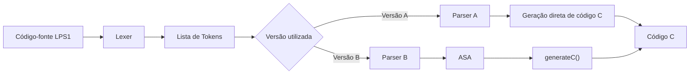
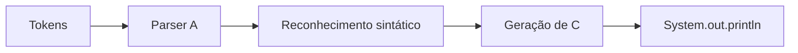
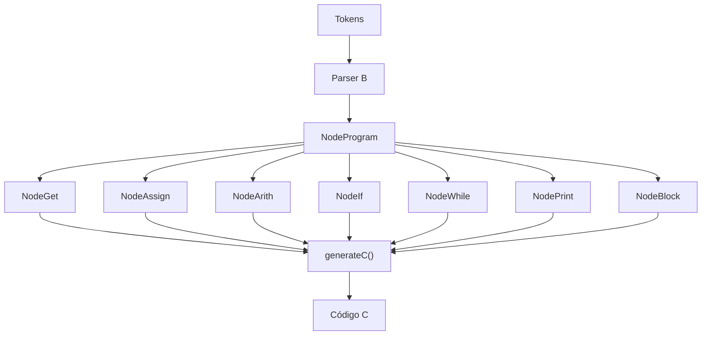
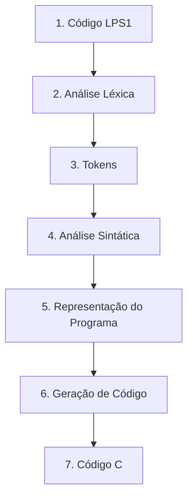
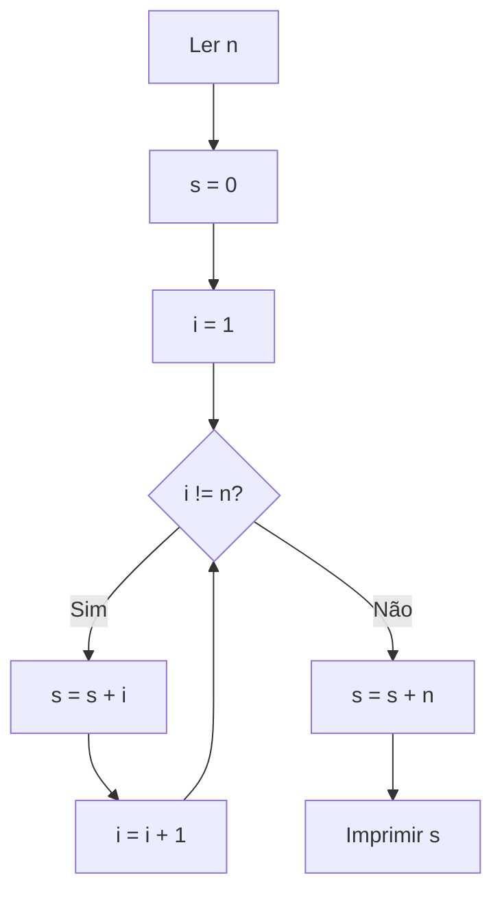
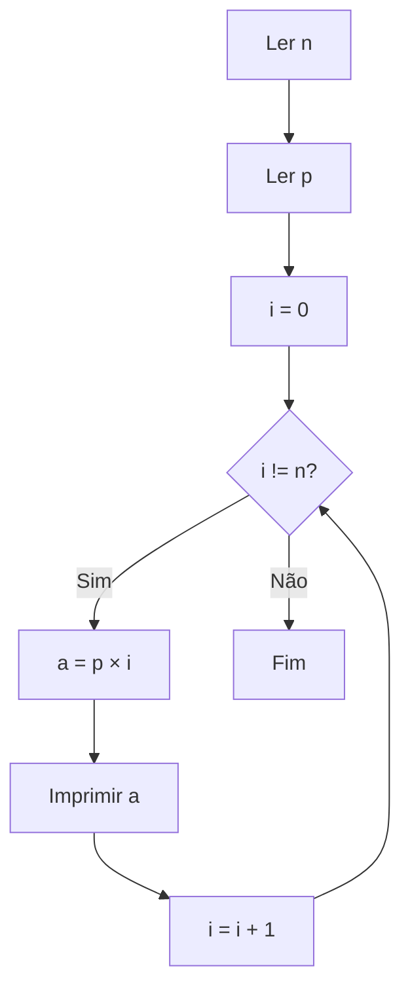
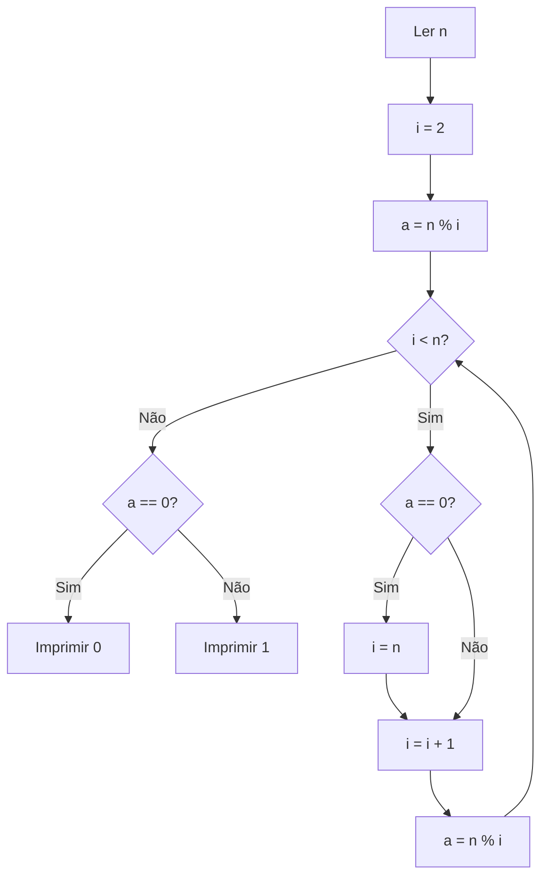
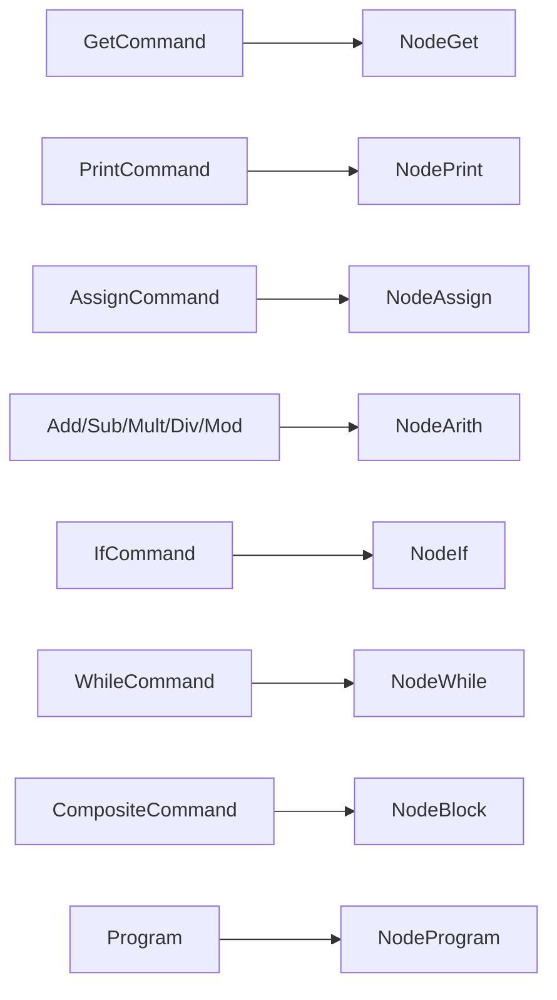
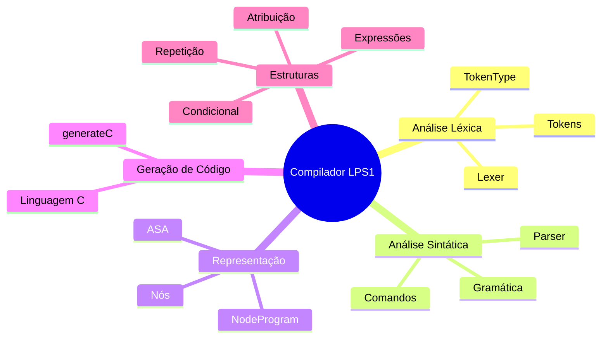

# Compilador LPS1

### Projeto B — TCD de Compiladores | Centro Universitário de Brasília — CEUB

> Implementação de um compilador para a linguagem **LPS1 — Linguagem de Programação Simples 1**, utilizando Java e geração de código C.

---

## Visão Geral

Este repositório contém a implementação de um compilador para a linguagem **LPS1 (Linguagem de Programação Simples 1)**, desenvolvido como parte do Trabalho de Conclusão da Disciplina (TCD) de **Compiladores** do Centro Universitário de Brasília — CEUB.

A proposta consiste na construção de um compilador capaz de realizar:

- análise léxica;
- análise sintática;
- construção de uma **Árvore Sintática Abstrata (ASA)**;
- geração de código na linguagem C.

A implementação utiliza um vocabulário inspirado no latim e foi desenvolvida integralmente em **Java**.

---

## Características da LPS1

A LPS1 é uma linguagem propositalmente minimalista.

| Característica | Descrição |
|---|---|
| Palavras-chave | Uma única letra maiúscula |
| Variáveis | Letras minúsculas de `a` até `z` |
| Tipo de dados | Apenas `int` |
| Declaração de variáveis | Automática |
| Números | Dígitos de `0` a `9` |
| Blocos | Delimitados por `{` e `}` |
| Código de saída | Linguagem C |

---

## Arquitetura do Compilador

O fluxo geral de compilação pode ser representado da seguinte forma:



O projeto possui duas abordagens diferentes para a geração de código.

### Versão A — Geração de código embutida

Nesta abordagem, o analisador sintático gera o código C diretamente durante o processamento dos comandos da linguagem.



As instruções responsáveis pela geração de código ficam misturadas à lógica do parser.

### Versão B — Parser + ASA

Nesta versão, o parser primeiro constrói uma **Árvore Sintática Abstrata (ASA)**.

Cada nó da árvore implementa o método:

```java
generateC()
```

Esse método é responsável por produzir o código C correspondente à construção representada pelo nó.



Essa abordagem proporciona maior separação entre:

- análise sintática;
- representação interna do programa;
- geração de código.

---

# Compilação e Execução

## Pré-requisitos

Para executar o projeto, é necessário possuir:

- **Java Development Kit (JDK)**;
- terminal compatível com os comandos apresentados abaixo.

É possível verificar a instalação do Java utilizando:

```bash
java -version
javac -version
```

---

## Compilando o projeto

Na raiz do repositório, execute:

```bash
javac -d bin src/App.java src/lexer/*.java src/versaoA/*.java src/versaob/*.java
```

Os arquivos `.class` serão armazenados no diretório `bin`.

---

## Executando

```bash
java -cp bin App
```

Para armazenar o código C gerado em um arquivo:

```bash
java -cp bin App > saida.txt
```

O arquivo `saida.txt` conterá o código C produzido pelo compilador.

---

## Compilar e executar em um único comando

```bash
javac -d bin src/App.java src/lexer/*.java src/versaoA/*.java src/versaob/*.java ; java -cp bin App > saida.txt
```

---

# Linguagem LPS1

## Comandos

O vocabulário da linguagem utiliza palavras inspiradas no latim.

| Token | Nome | Operação | Exemplo equivalente em C |
|:---:|---|---|---|
| `L` | *Lege* | Leitura de valor | `sscanf(str, "%d", &a);` |
| `D` | *Dic* | Impressão | `printf("%d\n", a);` |
| `P` | *Pone* | Atribuição | `a = b;` |
| `S` | *Si* | Condicional | `if (cond) { ... }` |
| `R` | *Repete* | Repetição | `while (cond) { ... }` |

---

## Operadores aritméticos

| Token | Nome | Exemplo |
|:---:|---|---|
| `+` | *Adde* | `a = b + c;` |
| `-` | *Subtrahe* | `a = b - c;` |
| `*` | *Multiplica* | `a = b * c;` |
| `/` | *Divide* | `a = b / c;` |
| `%` | *Modulus* | `a = b % c;` |

---

## Operadores de comparação

| Token | Nome | Significado | Equivalente C |
|:---:|---|---|:---:|
| `=` | *Aequalis* | Igual a | `==` |
| `<` | *Minor* | Menor que | `<` |
| `#` | *Diversus* | Diferente de | `!=` |

---

## Variáveis, valores e blocos

As variáveis da LPS1 são representadas pelas letras minúsculas:

```text
a b c d ... x y z
```

Todas são automaticamente tratadas como variáveis do tipo:

```c
int
```

Os valores numéricos aceitos pela gramática são dígitos simples:

```text
0 1 2 3 4 5 6 7 8 9
```

Comandos compostos são delimitados por:

```text
{
    ...
}
```

---

# Fluxo de Tradução

Um programa escrito em LPS1 percorre as seguintes etapas:



Na versão A, a etapa de representação intermediária é praticamente eliminada, pois a geração ocorre diretamente no parser.

Na versão B, a representação intermediária corresponde à **ASA**.

---

# Exemplos

## Exemplo 1 — *Summa*

O exemplo `Summa` lê um valor `n` e calcula a soma de todos os números inteiros no intervalo de `1` até `n`.

### Código LPS1

```text
L n
P s 0
P i 1
R i # n {
  + s s i
  + i i 1
}
+ s s n
D s
```

### Fluxo do algoritmo



### Código C gerado

```c
#include <stdio.h>

int main() {
  int a, b, c, d, e, f, g, h, i, j, k, l, m;
  int n, o, p, q, r, s, t, u, v, w, x, y, z;

  char str[512];

  // L n
  { gets(str); sscanf(str, "%d", &n); }

  // P s
  s = 0;

  // P i
  i = 1;

  while (i != n) {
    // + s s i
    s = s + i;

    // + i i 1
    i = i + 1;
  }

  // + s s n
  s = s + n;

  // D s
  printf("%d\n", s);
}
```

---

## Exemplo 2 — Múltiplos de `p`

O programa recebe dois números, `n` e `p`, e imprime os `n` primeiros múltiplos de `p`, iniciando em zero.

### Código LPS1

```text
L n
L p
P i 0
R i # n {
  * a p i
  D a
  + i i 1
}
```

### Fluxo do algoritmo



### Código C gerado

```c
#include <stdio.h>

int main() {
  int a, b, c, d, e, f, g, h, i, j, k, l, m;
  int n, o, p, q, r, s, t, u, v, w, x, y, z;

  char str[512];

  // L n
  { gets(str); sscanf(str, "%d", &n); }

  // L p
  { gets(str); sscanf(str, "%d", &p); }

  // P i
  i = 0;

  while (i != n) {
    // * a p i
    a = p * i;

    // D a
    printf("%d\n", a);

    // + i i 1
    i = i + 1;
  }
}
```

---

## Exemplo 3 — Verificador de primalidade

O programa verifica, de forma simplificada, se um número possui divisores inteiros entre `2` e `n - 1`.

### Código LPS1

```text
L n
P i 2
% a n i
R i < n {
  S a = 0 P i n
  + i i 1
  % a n i
}
S a = 0 D 0
S a # 0 D 1
```

### Fluxo simplificado



### Código C gerado

```c
#include <stdio.h>

int main() {
  int a, b, c, d, e, f, g, h, i, j, k, l, m;
  int n, o, p, q, r, s, t, u, v, w, x, y, z;

  char str[512];

  // L n
  { gets(str); sscanf(str, "%d", &n); }

  // P i
  i = 2;

  // % a n i
  a = n % i;

  while (i < n) {
    if (a == 0) {
      // P i
      i = n;
    }

    // + i i 1
    i = i + 1;

    // % a n i
    a = n % i;
  }

  if (a == 0) {
    // D 0
    printf("%d\n", 0);
  }

  if (a != 0) {
    // D 1
    printf("%d\n", 1);
  }
}
```

### Funcionamento

O algoritmo:

1. lê o valor de `n`;
2. inicializa `i` com `2`;
3. calcula `n % i`;
4. verifica possíveis divisores enquanto `i < n`;
5. ao encontrar um divisor exato, força o encerramento do laço;
6. imprime:
   - `0` quando um divisor é encontrado;
   - `1` quando nenhum divisor é encontrado.

Trata-se de uma implementação simplificada de um teste de primalidade, adequada ao conjunto reduzido de instruções disponível na LPS1.

---

# Estrutura do Projeto

```text
compilador-lps1/
│
└── src/
    │
    ├── lexer/
    │   ├── TokenType.java
    │   ├── Token.java
    │   └── Lexer.java
    │
    ├── versaoA/
    │   └── ParserA.java
    │
    ├── versaob/
    │   ├── Node.java
    │   ├── NodeGet.java
    │   ├── NodePrint.java
    │   ├── NodeAssign.java
    │   ├── NodeArith.java
    │   ├── NodeIf.java
    │   ├── NodeWhile.java
    │   ├── NodeBlock.java
    │   ├── NodeProgram.java
    │   └── ParserB.java
    │
    └── App.java
```

### Responsabilidade dos componentes

| Componente | Responsabilidade |
|---|---|
| `Lexer.java` | Realiza a análise léxica do código LPS1 |
| `Token.java` | Representa um token identificado |
| `TokenType.java` | Define os diferentes tipos de tokens |
| `ParserA.java` | Executa parsing e geração direta de código |
| `ParserB.java` | Executa parsing e constrói a ASA |
| `Node.java` | Interface comum dos nós da ASA |
| `NodeProgram.java` | Representa a raiz do programa |
| `NodeGet.java` | Representa o comando `L` |
| `NodePrint.java` | Representa o comando `D` |
| `NodeAssign.java` | Representa o comando `P` |
| `NodeArith.java` | Representa operações aritméticas |
| `NodeIf.java` | Representa estruturas condicionais |
| `NodeWhile.java` | Representa estruturas de repetição |
| `NodeBlock.java` | Representa blocos compostos |
| `App.java` | Ponto de entrada da aplicação |

---

# Gramática da LPS1

A gramática utilizada pelo compilador é definida da seguinte forma:

```text
Program          ::= Command { Command }

Command          ::= AssignCommand
                   | GetCommand
                   | AddCommand
                   | SubCommand
                   | MultCommand
                   | DivCommand
                   | ModCommand
                   | PrintCommand
                   | IfCommand
                   | WhileCommand
                   | CompositeCommand

AssignCommand    ::= P Variable Value

GetCommand       ::= L Variable

AddCommand       ::= + Variable Value Value

SubCommand       ::= - Variable Value Value

MultCommand      ::= * Variable Value Value

DivCommand       ::= / Variable Value Value

ModCommand       ::= % Variable Value Value

PrintCommand     ::= D Value

Comparison       ::= Variable Operator Value

IfCommand        ::= S Comparison Command

WhileCommand     ::= R Comparison Command

CompositeCommand ::= { Command { Command } }

Value            ::= Variable | Number
```

---

# Relação entre Gramática e ASA

Na versão B, construções reconhecidas pela gramática são transformadas em nós da Árvore Sintática Abstrata.



---

# Comparação das Duas Implementações

| Aspecto | Versão A | Versão B |
|---|---|---|
| Análise sintática | Sim | Sim |
| Geração de código | Durante o parsing | Após construção da ASA |
| Árvore Sintática Abstrata | Não | Sim |
| Método `generateC()` | Não | Sim |
| Separação de responsabilidades | Menor | Maior |
| Estrutura | Mais direta | Mais modular |
| Complexidade estrutural | Menor | Maior |

As duas versões produzem código C por meio da saída padrão utilizando:

```java
System.out.println(...)
```

---

# Decisões de Projeto

| ID | Decisão |
|:---:|---|
| D-01 | Utilização da linguagem LPS1 com vocabulário latino |
| D-02 | Palavras-chave definidas como `L`, `D`, `P`, `S` e `R` |
| D-03 | Operadores aritméticos representados por `+`, `-`, `*`, `/` e `%` |
| D-04 | Comparadores `=`, `<` e `#` mantidos conforme especificação |
| D-05 | Blocos compostos delimitados por `{` e `}` |
| D-06 | Variáveis representadas por letras minúsculas e tratadas automaticamente como `int` |
| D-07 | Exemplo adicional *Summa* para demonstrar a linguagem |
| D-08 | Implementação integral em Java |
| D-09 | Código C produzido por meio de `System.out.println` |
| D-10 | Organização do projeto em `lexer`, `versaoA` e `versaob` |
| D-11 | Tradução dos exemplos propostos para o vocabulário latino da LPS1 |
| D-12 | Possibilidade de salvar o código gerado em `saida.txt` por redirecionamento de saída |

---

# Tratamento de Erros

O compilador possui tratamento de erros relacionados à estrutura léxica e sintática da linguagem.

Entre as mensagens previstas estão:

```text
Caractere inválido
```

e:

```text
Comando inexistente
```

O projeto não implementa uma etapa completa de análise semântica.

Consequentemente, verificações como compatibilidade de tipos, escopo ou declaração explícita de variáveis não fazem parte da implementação.

---

# Limitações

Por definição da própria LPS1 e do escopo do projeto:

- existe apenas o tipo `int`;
- variáveis possuem nomes de apenas uma letra;
- números previstos pela gramática possuem apenas um dígito;
- não há funções;
- não há vetores;
- não há estruturas;
- não há análise semântica completa;
- não há otimização de código;
- o compilador gera exclusivamente código C.

---

# Itens de Entrega

De acordo com os requisitos do projeto, os seguintes materiais devem ser apresentados:

1. folha de capa disponibilizada pelo SGI;
2. listagem do código-fonte da versão **(a)**, identificada com `// (a)`;
3. listagem do código-fonte da versão **(b)**, identificada com `// (b)`;
4. código C gerado para o primeiro exemplo;
5. código C gerado para o segundo exemplo;
6. código C gerado para o exemplo próprio *Summa*;
7. explicação, em português, do funcionamento do segundo exemplo.

---

# Tecnologias Utilizadas

| Tecnologia | Finalidade |
|---|---|
| Java | Implementação do compilador |
| C | Linguagem-alvo da geração de código |
| Git | Controle de versão |
| GitHub | Hospedagem e documentação do projeto |
| Mermaid | Diagramas presentes na documentação |

---

# Conceitos Aplicados

O desenvolvimento deste projeto envolve conceitos fundamentais da construção de compiladores:



---

# Autor

Projeto acadêmico desenvolvido para a disciplina de **Compiladores** do **Centro Universitário de Brasília — CEUB**.

---

## Licença

Este projeto possui finalidade acadêmica e educacional.

Caso seja reutilizado como referência, recomenda-se indicar a origem do trabalho.
